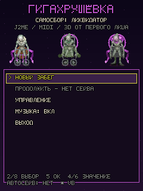
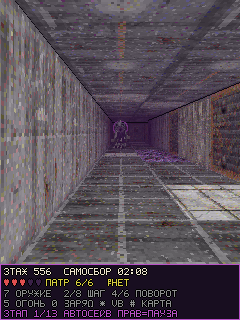
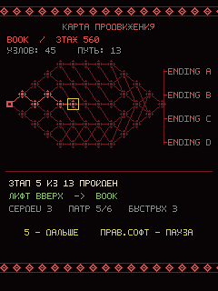
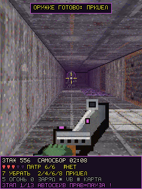
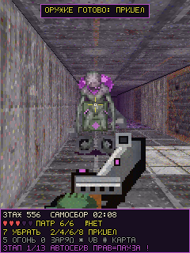
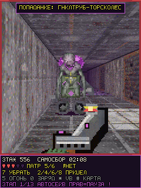
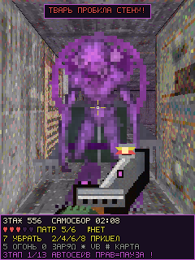
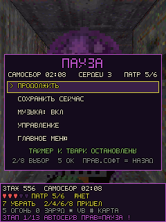
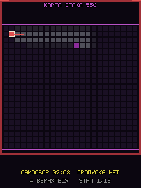
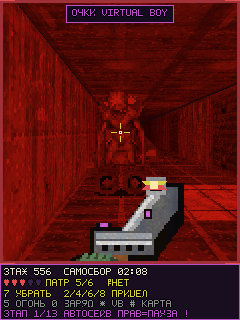

# Гигахрущёвка: САМОСБОР

**J2ME-рогалик от первого лица по вселенной «Самосбор» с геймплеем Insmouse no Yakata
(Virtual Boy, 1995).** Рейкастинг-3D, процедурные этажи бесконечной Гигахрущёвки,
процедурные твари, собранные из разных частей тела, MIDI-музыка и звуки, таймер до
Самосбора, автосохранение и четыре концовки.





---

## Что получилось

| | |
|---|---|
| Платформа | Java ME, **CLDC 1.1 / MIDP 2.0 / JSR-135 MMAPI / RMS**, `javac -source 1.3 -target 1.3` |
| Графика | рейкастинг (DDA) + **фотореалистичные 64×64 текстуры** (настоящий бетон, кафель, ржавчина, трещины, слизь), **фотографические спрайты тварей**, z-buffer, плотный туман, FP-оружие и прицел |
| Камера | **плавный доворот на 90° за 230 мс** (ease-in-out, дробный угол 1/16°), логика шага/карты/сейва осталась мгновенной и пошаговой |
| Геймплей | по клеткам, поворот на 90°, `7` — режим прицеливания, ключ → гермодверь, жёсткий таймер |
| Процедурное | **широкие коридоры Insmouse no Yakata** (двуклеточные проходы + редкие залы 4×3…5×4, минимум петель) — тварям есть где обойти сбоку; предметы, **монстры из частей тела + фото-анатомия**, ветвление маршрута |
| Между этажами | **карта продвижения**: красно-чёрное дерево из 45 узлов (названия этажей из ROM), 13 колонок, 4 концовки, орнаментальная рамка |
| Рогалик | свой seed на забег, 13 этажей за прохождение, **RMS-автосохранение** вместо паролей |
| Звук | 14 MIDI-файлов: зацикленная тема, сирена за 30 с и 12 эффектов (MMAPI, без Stream) |
| ИИ тварей | медленное блуждание у «дома», короткое зрение, **замах 0.8 с**, 1 сердце за укус, отпрыгивание после выстрела, **боковой обход в широком коридоре**, **пробой треснувшей стены** |
| Пауза | **правая софт-клавиша**: меню с замороженным таймером и тварями, автосейв, музыка, помощь, выход в меню |
| ROM | присланный `.jpg` переименован в `.vb`, заголовок/таблица паролей разобраны — см. [сверку](engine/rom/ROM-ANALYSIS.md) |
| Концовки | **4** (A/B/C/D) + смерть ликвидатора |
| Проверка | автоматический **SelfTest (3376 проверок)**, включая регрессию старта на J2ME Loader, живое превью в браузере, StackMap для реального KVM |

**Готовые файлы для телефона:** `dist/GigaKhrushchyovka.jar` + `dist/GigaKhrushchyovka.jad`.

---

## Геймплей (как в Insmouse no Yakata)

Вы — **ликвидатор**. Система оповещения дала отсчёт до **Самосбора**. На каждом
этаже надо:

1. найти **пропуск Партии** (аналог ключа);
2. дойти до **гермодвери** (аналог exit door) и войти в неё;
3. успеть до нуля на таймере — иначе Самосбор наступает прямо в коридоре.

По пути:

* **Белый шар** — открывает всю карту этажа;
* **Чёрный шар** — показывает на карте предметы, пропуск и гермодверь;
* **патроны** (+6 в резерв), **пищконцентрат** (+1 сердце), **талон** (+20 секунд);
* **Ералашников**: 6 патронов в магазине, перезарядка **вручную** (клавиша `0`);
* старт — **3 сердца**, твари снимают ровно **одно** за укус и только после заметного замаха;
* на каждую тварь уходит **ровно 2–8 пуль** (число выводится из её частей тела и
  не меняется от выстрела к выстрелу) — как в ROM;
* твари блокируют коридоры (толчок о тварь **не ранит**), **пробивают треснувшие
  стены** и врываются в пролом с телеграфированным выпадом, возрождаются через 20 с;
* стрелять можно **только достав оружие** кнопкой `7`: появляется прицел и спрайт
  оружия от первого лица. **После убирания оружия прицел возвращается в центр экрана**;
* на экране карты **таймер и твари замирают** — как в оригинале.

После этажа оставшееся время решает маршрут: **>50 % — лифт вверх, иначе вниз**
(как ветвящаяся «ёлка» из 45 этажей в оригинале, только этажи генерируются, а не
захардкожены). За прохождение вы видите 13 этажей из диапазона 540…585.

**Карта продвижения между этажами.** Сразу после гермодвери показывается отдельный
экран в духе приложенного скриншота: чёрное поле, красно-чёрная орнаментальная
кайма сверху и снизу, слева название текущего узла (`ROPE`, `ROAD`, `LOVE` … — 45
обозначений из таблицы ROM `0x415C0`, без `DEMO`), ветвящееся дерево круглых
узлов-крестиков и справа `ENDING A/B/C/D`. Пройденные узлы горят ярко-красным,
текущий мигает жёлтым, быстрая развилка уходит вверх, медленная — вниз; кнопка `5`
ведёт к брифингу следующего этажа, правая софт-клавиша открывает паузу прямо с
карты. Выбор ветки сохраняется в RMS (`SAVE_VERSION = 5`), так что «Продолжить»
возвращает на тот же экран. Это **не парольный экран**: обозначения используются
только как названия этажей, пароли по-прежнему заменены автосейвом.

### Концовки

| | Условие | Смысл |
|---|---|---|
| **A** | ≥10 быстрых этажей, ни одной смерти, запас времени | гермодверь, двойной паёк, выход |
| **B** | сбежал, но без патронов / впритык | паёк выдают посмертно |
| **C** | медленный, но живой забег | Самосбор превращает ликвидатора в тварь |
| **D** | уход на нижние «нежилые» этажи | шутка Партии: обратно на этаж 556 |
| **—** | смерть / таймер истёк | «ЛИКВИДАТОР НЕ ВЕРНУЛСЯ», автосейв откатывает к началу этажа |

**Пароли убраны.** Вместо них — RMS: снимок пишется в `gh_auto` каждые 12 секунд,
при подборе предмета, на паузе/сворачивании и на старте каждого этажа; отдельный
`gh_floor` хранит начало этажа. После смерти `gh_floor` копируется в `gh_auto`, так
что «Продолжить с этажа» не возвращает в уже проигранную ситуацию. Снимок содержит
карту, открытые клетки, предметы, все части тела/HP/позиции тварей, таймер, прицел,
режим VB и настройку звука.

---

## Управление

| Клавиша | Действие |
|---|---|
| `2` / `8` | оружие убрано: шаг **вперёд / назад на клетку** |
| `4` / `6` | оружие убрано: поворот влево / вправо ровно на **90°** — логика мгновенная, **камера доворачивает плавно** за 0.23 с |
| **`7`** | **достать оружие → режим прицеливания** (прицел + FP-спрайт); повторно — убрать и вернуть прицел в центр |
| `2` / `4` / `6` / `8` | **в режиме прицеливания**: движение прицела вверх / влево / вправо / вниз |
| `5` / `FIRE` | выстрел (только с оружием) |
| `0` | ручная перезарядка (6 патронов в магазине) |
| `*` | **очки Virtual Boy** — красно-чёрный монохромный режим |
| `#` | **карта этажа** (в оригинале `Select`; таймер и твари замирают) |
| **правая софт-клавиша** | **меню паузы**: «Продолжить», «Сохранить сейчас», «Музыка», «Управление», «Главное меню». Таймер, твари и прицел заморожены; при входе пишется автосейв |
| `2` / `8` в меню | классическое **перелистывание пунктов** вверх / вниз |
| `5` в меню | выбрать пункт |
| `4` / `6` / `1` / `3` в меню | изменить значение (например, «Музыка: вкл/выкл») |
| `9` | назад из экрана помощи / брифинга |
| `5` / `9` на **карте продвижения** | перейти к брифингу следующего этажа (экран показывается сам после каждого этажа) |

Главное меню: «Новый забег», «Продолжить» (если есть автосейв), «Управление»,
«Музыка: ВКЛ/ВЫКЛ», «Выход». Поддерживаются раскладки Nokia/SE, Siemens и Motorola
(определение D-pad'а взято из `classes.Keyboard` приложенного движка). Удержание
`2/8/4/6` даёт повтор шага; прицел двигается непрерывно.

### Запуск на J2ME Loader

В присланном логе MIDlet падал до первого кадра: `Failed startApp` ←
`IllegalArgumentException: unknown keycode -9` ← `Canvas.getKeyName()` ←
`Game.detectSoftKeys()`. Определение раскладки перебирает вендорские коды
`-1…-32`, а J2ME Loader на «чужих» кодах бросает исключение вместо пустой
строки. Теперь все четыре обращения к `getKeyName()` идут через `keyNameSafe()`
(ловит `Throwable`, возвращает `""`), само определение обёрнуто в `try/catch`,
а у правой софт-клавиши есть явный запасной код `-7` — цифровая клавиатура,
`norm()` и пауза не зависят от того, что вернул эмулятор.

Заглушка `tools/preview/stub/javax/microedition/lcdui/Canvas.java` намеренно
бросает **то же** исключение на неизвестных кодах, поэтому каждый `new Game()`
в SelfTest проверяет старт; отдельный `testJ2MELoaderStartup()` прогоняет
`norm()` по всему диапазону `-1…-32` и по коду `-9`. Лог с устройства —
реальное свидетельство падения, но отдельный KVM/эмулятор в песочнице не
запускался: собранный JAR проверен заглушками, StackMap и JAD.

### Плавный поворот камеры

Раньше `4`/`6` мгновенно подменяли вектор рейкастера на 90°, и вид «дёргался».
Теперь разделены два направления: **логическое** (`dirDeg` → шаг вперёд, стрелка
на карте, RMS-сейв) меняется сразу и ровно на 90°, а **визуальная камера**
доворачивается за `TURN_MS = 230` мс по smoothstep (ease-in-out, без рывка на
старте и в конце). Угол хранится в единицах **1/16 градуса**; `Fx.sinFine()` /
`Fx.cosFine()` линейно интерполируют таблицы sin/cos из Mecasting — всё
целочисленное, без `float`, `Math` и аллокаций в кадре, как требует CLDC 1.1.
Интервал повтора при удержании `4`/`6` равен длительности доворота, поэтому
длинное вращение идёт непрерывно; новые нажатия не теряются, а накапливаются в
цели. На старте этажа и при «Продолжить» камера сразу совмещена с направлением
(`snapCamera()`), так что сейв не открывается «недокрученным» видом.
SelfTest проверяет дробные sin/cos, промежуточное положение камеры, точное
совпадение с логикой после завершения и отрисовку во время доворота.

### Живое превью в браузере

В превью играет **тот же скомпилированный `samosbor.Game`** на заглушках
MIDP/MMAPI/RMS (не JS-порт): `W/A/S/D` или стрелки — шаг/поворот либо прицел,
`G`/`7` — достать оружие, `Space`/`5` — огонь/выбор, `R`/`0` — перезарядка,
`M`/`#` — карта, `V`/`*` — очки Virtual Boy, `P`/`F2` — правая софт-клавиша
(пауза), `N`/кнопка «КАРТА ПУТИ» — мгновенно показать дерево этажей (только
превью; в игре экран появляется сам между этажами). MIDI на JDK-заглушках не
звучит, поэтому эффекты дублируются синтезатором WebAudio (кнопка
«ВКЛЮЧИТЬ ЗВУК»).

```sh
./build.sh                                # собрать JAR, JAD, превью, скриншоты
java -cp build/preview:res samosbor.Preview 8080    # http://localhost:8080
```










Дополнительно: [перелистывание меню](docs/screenshots/menu-nav.png),
[брифинг этажа](docs/screenshots/brief.png).

---

## Процедурная генерация

**Этаж** (`src/samosbor/Level.java`):

* размер 21…31 клеток, растёт с номером этапа;
* лабиринт randomized DFS по сетке с шагом **3** (`NODE_STEP`): узел — квадрат
  2×2, проход между узлами — тоже **две клетки в ширину**, между параллельными
  коридорами остаётся одна клетка стены. Это планировка по скриншотам
  Insmouse no Yakata, а не одноклеточные щели из первой версии;
* **2–3 зала 4×3…5×4** (широкая площадка с боковыми проёмами, где тварь
  разворачивается), петель по-прежнему 7 %, так что тупики и извилистые обходы
  сохраняются. Тесноту дают узкий угол обзора 5/8 и туман, который наступает на
  25 % быстрее, а не ширина прохода. В SelfTest на 60 этажах проверяется
  **≥80 % «широких» клеток** (не менее 5 полов в окне 3×3), **≥78 % клеток с
  шагом вбок** (3+ свободных соседа), **≥6 залов 3×3** и **≥18 % стен**, чтобы
  этаж не превратился в открытое поле; связность по-прежнему гарантируется
  BFS/`connectAll()`;
* у каждой твари в среднем ≥2 свободных соседних клетки (тоже проверяется),
  а при виде игрока на дистанции 2–5 клеток она с шансом 30 % уходит вбок,
  перпендикулярно линии атаки — `Game.trySidestep()`. Раньше в узком коридоре
  такой шаг был просто некуда делать;
* стены получают тип/текстуру: бетон, облупившаяся краска, кафель, дверь квартиры,
  окно в соседний блок, агитплакат Партии, трубы, решётка, кирпич, «КЛЕТЬ»,
  треснувшая стена (её могут проломить твари); дверей квартир стало больше, чтобы
  коридор читался как жилой подъезд;
* гермодверь ставится у самой дальней клетки, пропуск — примерно на 60 % пути;
* лимит времени = `55 + maxDist + maxDist/2 + число тварей` секунд (70…210);
* всё детерминировано `Rng(seed ^ этаж ^ этап)` — снимок RMS восстанавливает этаж
  бит в бит вместе с разведанной картой.

**Монстр** (`src/samosbor/Monster.java`) — не спрайт из файла, а сборка ГПСЧ:

| Часть | Варианты |
|---|---|
| Голова | голова, противогаз, гнилушка, глаз, телевизор, без головы |
| Торс | торс, бочка, бетонная панель, клеть, сросток, костюм ликвидатора |
| Руки | руки, тентакли, грабли, трубы, клешни, безрукий |
| Ноги | ноги, лапы, корни, колёса, одноног, парит |
| Лишнее | слизь, лишние глаза, спинные щупальца, ржавчина, фиолетовый ореол |

Из частей считаются **HP 2…8** (ровно столько пуль уходит на тварь, как в ROM),
**скорость 1150…2700 мс на клетку**, **урон 1**, дальность чутья 3–5 клеток,
пауза между укусами ≥5.6 с и имя (`ГНИЛОТЕНТАКЛ-СРОСТКОРН` и т.п.). Два кадра
(«стоит» / «замах») рисуются мини-растеризатором `Raster` прямо в `int[]`, без
`Image` и без аллокаций в кадре. 6·6·6·6·6 = 7776 базовых комбинаций, плюс
4 палитры и рост характеристик с этажом.

### Фотореалистичные текстуры и спрайты

`tools/gen_textures.py` больше не рисует стены плоскими 64-цветными заливками.
Настоящие фото-поверхности (бетон с ржавыми потёками, кафель с грибком,
корродированная сталь, трещина с арматурой, фиолетовая биоплёнка) смешиваются с
процедурной разметкой (швы, заклёпки, дверные проёмы, плакаты), после чего
квантуются в **256-цветную палитру с дизерингом Флойда–Стейнберга**. Формат
остался самым совместимым с MIDP: 64×64, power-of-two, PNG color type 3 / 8 bit,
`PLTE` на 256 записей — `Image.createImage()` читает его и на телефоне, и в
заглушке ImageIO. Компактные фото-основы лежат в `tools/photo_src/base_*.png`
(~10 КБ каждая); большие ИИ-исходники в репозиторий не кладутся, промпты и
скрипт подготовки — в `tools/photo_src/README.md` / `prepare.py`.

Спрайты тоже фотографические. `res/textures/skin0..3.png` (40×56) дают поры, вены
и влажные блики, а `res/textures/beast0..3.png` — изолированное на чёрном фоне
фото твари, четыре цветовые морфы под четыре палитры. `Monster.applyPhotoSkin()`
берёт ГПСЧ-растр как «скелет» (форма головы, рук, ног, лишней детали и окраска),
а поверх на 78 % подмешивает реальную фотографию: где снимок светел — видна
настоящая анатомия, где фон чёрен — остаются процедурные примитивы с кожной
фактурой; глаза и свечение не перекрашиваются, чтобы тварь читалась и в
красно-чёрном режиме Virtual Boy. `Raster.photoGrain()` добавляет ржавую сталь на
FP-оружие и предметы. Все PNG грузятся через `Texture.load()` с `solid()`-фолбэком.

**Поведение тварей (исправлено по замечанию «убивают слишком быстро» и сверено
с ROM):** твари больше не бегут к игроку через весь этаж по BFS. Они медленно
бродят в радиусе 3 клеток от точки появления (в ROM — «start in the same spot,
but will roam around»), могут стрейфить, замечают игрока только при прямой
видимости (`Level.lineOfSight`, Брезенхем), перед укусом замирают в позе выпада
на 0.8 с — это видно по кадру спрайта, удар можно переждать или отойти. Попадание
заставляет тварь отпрыгнуть в сторону от прицела. Глобальный cooldown урона —
2.6 с, так что толпа не может съесть три сердца за секунду.

**Пробой стены.** В картах оригинала такие стены помечены `B = Monsters can break
through this wall`. Наш аналог — `Level.CRACKED` (~5 % внутренних стен). Если
тварь рядом (≤4 клеток), но стена закрывает прямую видимость, она ломает
перегородку (`Audio.BREACH`), шагает в пролом и лишь потом проводит
телеграфированный выпад — ровно одно сердце, без «мгновенной смерти из стены».
Через двери твари не проходят, как и в ROM.

### ROM прислан: прямое сравнение

`.jpg` с ROM переименован в `engine/rom/Insmouth_Mansion_Japan_T-En_Thunderstruck_v1.0.vb`
(1 МиБ, код V810). По адресу `0xFFDE0` прочитан заголовок Virtual Boy:
`Innsmouth Mansion`, maker `8F`, game `VIME`, version `0`. По смещению
`0x415C0` извлечена таблица из **46 четырёхбуквенных паролей** — `ROPE … HYDE
DARK DEMO`, то есть 45 этажей и ветвящийся маршрут. Именно эти 45 слов (без
`DEMO`) теперь подписывают узлы **карты продвижения между этажами**. Подробная
сверка (включая «2–8 пуль», остановку таймера на карте и метки `B`) — в
[`engine/rom/ROM-ANALYSIS.md`](engine/rom/ROM-ANALYSIS.md). Парольный экран
не перенесён сознательно: по предыдущему требованию он заменён RMS-автосейвом,
а слова используются только как названия этажей.

---

## Сборка

```sh
./build.sh
```

Скрипт:

1. при необходимости скачивает **JDK 8** из
   [klaxons1/tools_linux_jdk8](https://github.com/klaxons1/tools_linux_jdk8)
   в `~/.cache/jdk8` (в репозиторий не кладётся);
2. генерирует **фотореалистичные текстуры** (`tools/gen_textures.py` из компактных
   основ `tools/photo_src/base_*.png`), встроенный кириллический шрифт
   5×7 (`tools/gen_font.py`) и **14 MIDI** (`tools/gen_audio.py`). Для
   пересборки `skin*/beast*` из больших ИИ-исходников — `tools/photo_src/prepare.py`;
3. компилирует `-source 1.3 -target 1.3` с `-bootclasspath` из
   `tools/cldc11.jar` + `tools/midp21.jar` + `tools/jsr135.jar` (MMAPI из
   LLM-J2ME-SUITE);
4. прогоняет **ProGuard 6.2.2 с `-microedition`** — добавляет атрибут `StackMap`,
   без которого JAR не стартует на реальном KVM/phoneme;
5. кладёт в JAR `res/textures/*.png` и `res/audio/*.mid`, собирает
   `dist/GigaKhrushchyovka.jar` и `.jad` с корректным `MIDlet-Jar-Size`;
6. собирает превью на заглушках MIDP/MMAPI/RMS, запускает `samosbor.SelfTest`
   (**3376 проверок**: старт на строгой заглушке J2ME Loader, связность 60 этажей,
   RMS-снимок/восстановление, спрайты, новый ИИ, пауза/возврат прицела, 2–8 пуль,
   пробой стены, остановка таймера на карте, ширина коридоров и место для
   манёвра тварей, дерево из 45 узлов и 4 концовок, плавный доворот камеры,
   полный забег до концовки A) и сохраняет
   **12 кадров** в `build/screenshots/`. Seed демонстрационного забега
   зафиксирован (`Game.demoSeed`, переопределяется свойством
   `samosbor.capture.seed`), поэтому планировка и ракурс в `docs/screenshots/`
   не меняются от сборки к сборке — лишь секунды таймера в HUD зависят от
   момента съёмки.

Рекомендации из `Agents.md` комплекта LLM-J2ME-SUITE соблюдены: fixed point
(`FP = 4096`, таблицы sin/cos из движка), никаких `float`/`Math.atan/floor/pow/log`,
никаких аллокаций в игровом цикле (строки HUD кэшируются), один поток, простые
горячие циклы, текстуры стен — индексированные PNG 64×64 с 256-цветной палитрой;
спрайтовые фото-текстуры 40×56 — truecolor PNG (тоже `Image.createImage()`).
`tools/preview/` в JAR **не** попадает.

---

## Структура

```
Mecasting.zip                     ← вложенный .jpg переименован обратно в .zip
engine/Mecasting/                 ← распакованный исходный рейкастинг-движок
engine/rom/*.vb                   ← ROM Insmouse no Yakata (.jpg → .vb) + ROM-ANALYSIS.md
tools/                            ← UEI + MMAPI + ProGuard из LLM-J2ME-SUITE, генераторы, превью
  gen_audio.py                    ← генератор 14 SMF/MIDI (тема, сирена, 12 SFX)
  gen_textures.py                 ← фото-основы + процедурная разметка → 256-цветные PNG
  photo_src/                      ← компактные base_*.png, prepare.py, промпты
  preview/stub/                   ← MIDP/MMAPI/RMS-заглушки для запуска игры на JDK 8
  preview/Preview.java            ← HTTP-превью (PNG-кадры + ввод + /events)
  preview/SelfTest.java           ← автоматические проверки (3376 checks)
src/samosbor/                     ← сама игра (Java 1.3)
  Fx.java                         ← fixed-point математика из Mecasting/MathEngine
                                    + sinFine/cosFine (угол 1/16°) для камеры
  Renderer.java                   ← DDA/рейкастинг из Mecasting/World + спрайты
  Raster.java                     ← мини-растеризатор + photoGrain()
  Audio.java                      ← JSR-135 MMAPI: MIDI-плеер и эффекты
  Save.java                       ← RMS-автосохранение (gh_auto / gh_floor)
  Level.java, Monster.java, ...   ← процедурщина, ИИ, состояния, HUD, концовки
  Game.java                       ← в т.ч. экран PROGRESS с деревом 45 узлов
res/textures/                     ← 16 фото-стен/полов + skin0..3 + beast0..3
res/audio/                        ← 14 MIDI-файлов
dist/GigaKhrushchyovka.jar/.jad   ← готовый MIDlet, версия 1.4.0
docs/screenshots/                 ← 12 кадров игры
```

---

## Благодарности и источники

* **Движок:** приложенный `Mecasting.jpg` → `Mecasting.zip`
  (рейкастинг-движок Романа Лагина, `game.World`, `MathEngine`, `Texture`, `Keyboard`).
  DDA-лучи, floor/ceiling casting, таблицы sin/cos и определение клавиатуры взяты
  оттуда и адаптированы под процедурные карты.
* **Инструменты:** [klaxons1/LLM-J2ME-SUITE](https://github.com/klaxons1/LLM-J2ME-SUITE) —
  UEI (`cldc11.jar`, `midp21.jar`, `jsr135.jar`), `proguard.jar`, `Agents.md`.
* **Геймплей-референс:** *Insmouse no Yakata* (Be Top / I'Max, Virtual Boy, 1995) —
  grid movement, свободный прицел, key + exit, таймер, белый/чёрный шары,
  13 из 45 этажей, 4 концовки. Присланный ROM (`VIME`, перевод Thunderstruck v1.0)
  разобран в `engine/rom/ROM-ANALYSIS.md`; Brian Hodges, *Insmouse GameFAQ* v1.1
  и MobyGames — карты с метками `B`, 2–8 пуль, остановка таймера на карте.
  Приложенный пользователем скриншот карты продвижения (`ROOM`, красные узлы,
  `ENDING A/B/C/D`, орнаментальная рамка) стал референсом для экрана `PROGRESS`.
  Спрайты и тексты оригинала **не копируются**: фото-материалы и фото твари
  сгенерированы заново для этого проекта.
* **Вселенная:** «Самосбор» (Двач, 2018) — Гигахрущёвка, Самосбор, ликвидаторы,
  гермодвери, Партия, пищконцентрат, тентакли, КЛЕТЬ, Ералашников, грабли.
  Лор сообщества намеренно гибкий — игра сделана как фанатская вариация.

Лицензия на код движка — согласно приложенному архиву; игровой код, текстуры,
шрифт, MIDI и генераторы написаны для этого проекта.
